# Detection evaluation

- Artifact SHA-256 `0c6f0fc1ec8159e9f4b0107ed0daef0ac3cfd6ef9585e214c5b808fd11dc7510`
- Dataset SHA-256 `f75b1e7ad2afd597b90530b236caee30d8192bd325634e30421513e2b127cadc`
- Dataset labels `coco2017-val-ingen-w04.2`
- Policy SHA-256 `bf2150ee659af1d04ce9ed2ae799482ad135403b7b5f003d20f3c6e0f42448d3`
- Benchmark `cpu-1thread-5warmup-v1/Darwin 24.6.0 arm64 Apple M4 Pro/ORT 1.22.1`
- Peak process RSS 320.3 MiB

| Slice | Images | Boxes | mAP 50–95 | AP50 | Images with FP | p50 ms | p95 ms |
| --- | ---: | ---: | ---: | ---: | ---: | ---: | ---: |
| overall | 140 | 547 | 26.68% | 38.35% | 65.71% | 61.48 | 63.51 |
| nominal | 20 | 61 | 45.91% | 60.55% | 60.00% | 61.20 | 64.47 |
| low_light | 20 | 61 | 31.86% | 48.52% | 70.00% | 61.95 | 63.07 |
| motion_blur | 20 | 61 | 33.38% | 43.71% | 60.00% | 60.81 | 61.96 |
| sensor_noise | 20 | 61 | 43.51% | 58.90% | 60.00% | 62.22 | 63.35 |
| small_thin | 20 | 176 | 27.97% | 40.06% | 95.00% | 62.20 | 63.56 |
| empty_scene | 16 | 0 | n/a | n/a | 0.00% | 60.34 | 61.89 |
| fari_indoor | 24 | 127 | 32.82% | 45.63% | 95.83% | 61.29 | 64.90 |

The runner ranks named foreground scores above the background score, caps each image at 100 detections and averages 101-point interpolated AP over IoU 0.50–0.95 and classes with ground truth. Empty frames use false-positive image rate at confidence 0.50. ONNX inference timing excludes decode, preprocessing and reporting. RSS is the OS-reported process high-water mark.

## Worst cases

Two cases per slice, ranked by misses plus false positives at confidence 0.50 and IoU 0.50. Green marks ground truth. Orange marks predictions.

### nominal-185409

2 missed and 17 false positives.
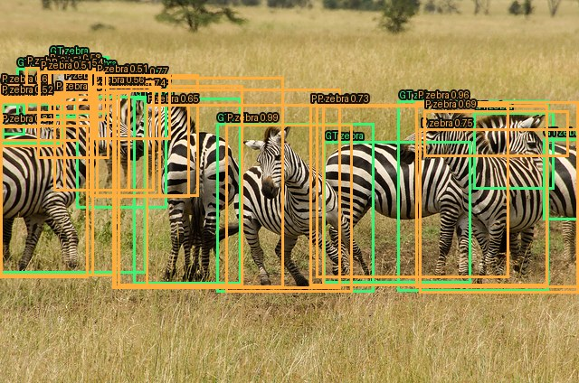

COCO image 185409 by Colin J. McMechan. Changes include bounding boxes. [Tanzania-Serengeti-MbuziMaweSafariDrive-6](https://www.flickr.com/photos/quakeup/8881324394/) · [CC-BY-2.0](https://creativecommons.org/licenses/by/2.0/)

### nominal-215245

2 missed and 8 false positives.
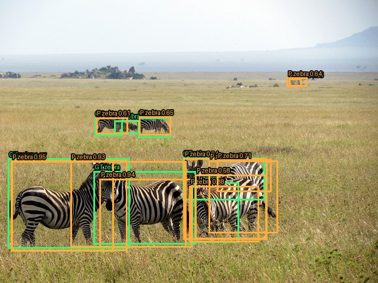

COCO image 215245 by David Berkowitz. Changes include bounding boxes. [Zebra - Serengeti National Park safari - Tanzania, Africa](https://www.flickr.com/photos/davidberkowitz/5699107573/) · [CC-BY-2.0](https://creativecommons.org/licenses/by/2.0/)

### low_light-185409

4 missed and 19 false positives.
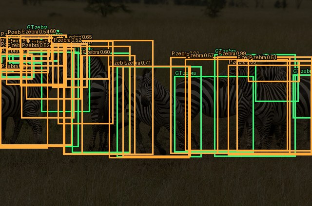

COCO image 185409 by Colin J. McMechan. Changes include low light and bounding boxes. [Tanzania-Serengeti-MbuziMaweSafariDrive-6](https://www.flickr.com/photos/quakeup/8881324394/) · [CC-BY-2.0](https://creativecommons.org/licenses/by/2.0/)

### low_light-215245

5 missed and 6 false positives.
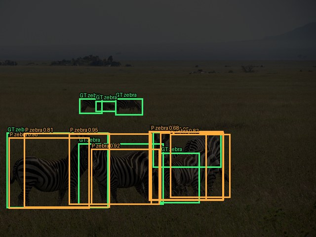

COCO image 215245 by David Berkowitz. Changes include low light and bounding boxes. [Zebra - Serengeti National Park safari - Tanzania, Africa](https://www.flickr.com/photos/davidberkowitz/5699107573/) · [CC-BY-2.0](https://creativecommons.org/licenses/by/2.0/)

### motion_blur-185409

7 missed and 9 false positives.
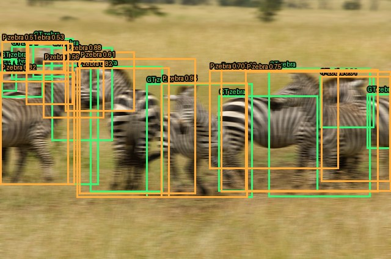

COCO image 185409 by Colin J. McMechan. Changes include motion blur and bounding boxes. [Tanzania-Serengeti-MbuziMaweSafariDrive-6](https://www.flickr.com/photos/quakeup/8881324394/) · [CC-BY-2.0](https://creativecommons.org/licenses/by/2.0/)

### motion_blur-215245

4 missed and 11 false positives.
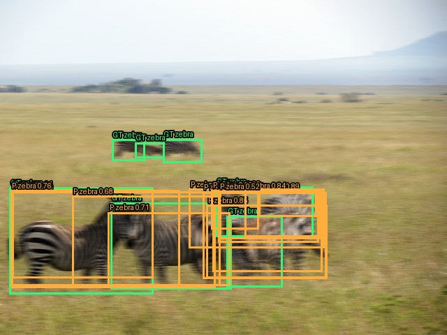

COCO image 215245 by David Berkowitz. Changes include motion blur and bounding boxes. [Zebra - Serengeti National Park safari - Tanzania, Africa](https://www.flickr.com/photos/davidberkowitz/5699107573/) · [CC-BY-2.0](https://creativecommons.org/licenses/by/2.0/)

### sensor_noise-185409

2 missed and 14 false positives.
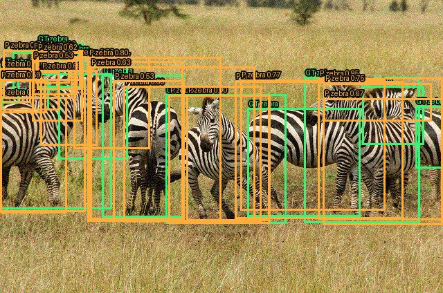

COCO image 185409 by Colin J. McMechan. Changes include sensor noise and bounding boxes. [Tanzania-Serengeti-MbuziMaweSafariDrive-6](https://www.flickr.com/photos/quakeup/8881324394/) · [CC-BY-2.0](https://creativecommons.org/licenses/by/2.0/)

### sensor_noise-215245

2 missed and 9 false positives.
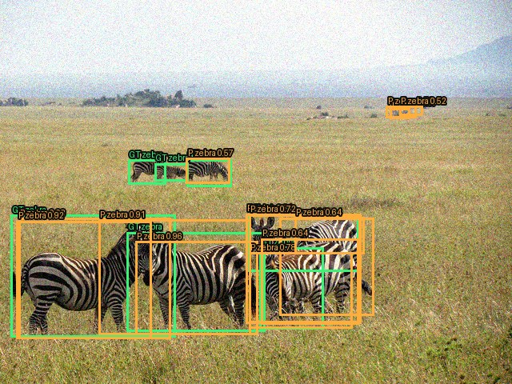

COCO image 215245 by David Berkowitz. Changes include sensor noise and bounding boxes. [Zebra - Serengeti National Park safari - Tanzania, Africa](https://www.flickr.com/photos/davidberkowitz/5699107573/) · [CC-BY-2.0](https://creativecommons.org/licenses/by/2.0/)

### small_thin-189820

9 missed and 35 false positives.
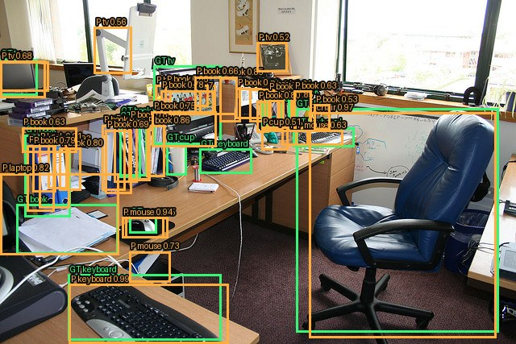

COCO image 189820 by Paul Furness. Changes include bounding boxes. [A Systems Manager's Empire](https://www.flickr.com/photos/bungle/32908206/) · [CC-BY-SA-2.0](https://creativecommons.org/licenses/by-sa/2.0/)

### small_thin-124659

15 missed and 22 false positives.
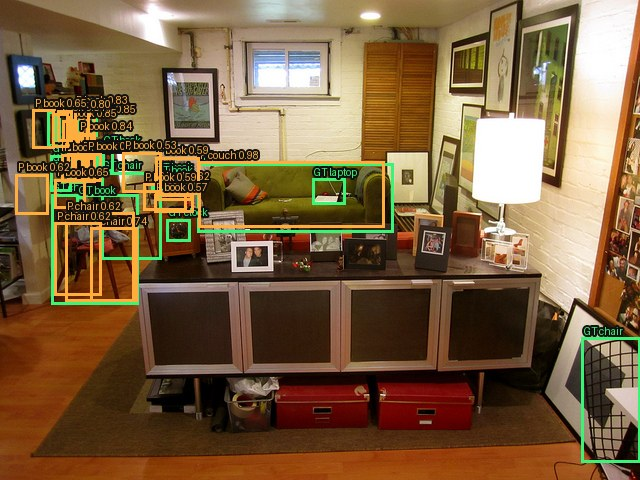

COCO image 124659 by Cherry Ride. Changes include bounding boxes. [View of the "Living Room" from the Kitchen.](https://www.flickr.com/photos/cherryride/5653997626/) · [CC-BY-2.0](https://creativecommons.org/licenses/by/2.0/)

### empty_scene-000001

0 missed and 0 false positives.

Procedural empty scene with evaluation overlays. [CC0 1.0](https://creativecommons.org/publicdomain/zero/1.0/)

### empty_scene-000002

0 missed and 0 false positives.

Procedural empty scene with evaluation overlays. [CC0 1.0](https://creativecommons.org/publicdomain/zero/1.0/)

### fari_indoor-298396

21 missed and 24 false positives.
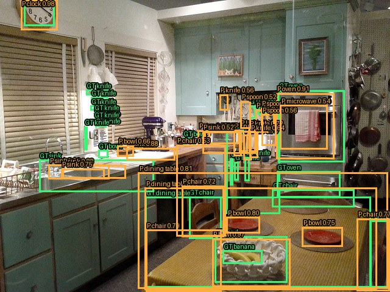

COCO image 298396 by Zach Copley. Changes include bounding boxes. [Julia Child's Kitchen - National Museum of American History](https://www.flickr.com/photos/zcopley/6348486215/) · [CC-BY-SA-2.0](https://creativecommons.org/licenses/by-sa/2.0/)

### fari_indoor-447522

4 missed and 32 false positives.
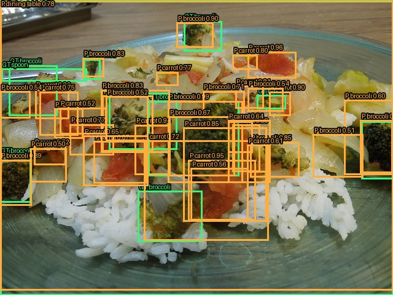

COCO image 447522 by ocbgraue. Changes include bounding boxes. [Broccoli, onion, tomato, rice 2/5](https://www.flickr.com/photos/graue/6847896207/) · [CC-BY-2.0](https://creativecommons.org/licenses/by/2.0/)
